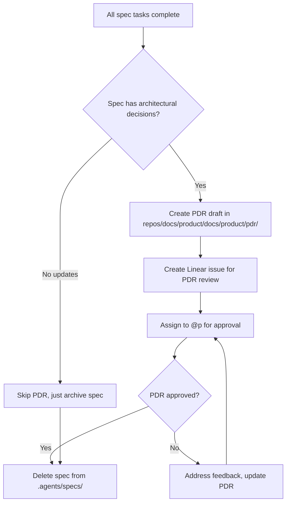

# Spec Lifecycle Management

## Overview

Specs drive feature implementation across submodules. When complete, key decisions get absorbed into Product Decision Records (PDRs) in `repos/docs/product/`. This document defines the lifecycle from creation to archival.

---

## 1. Spec Naming Convention

All specs follow `{feature}-{domain}` naming to group related work:

| Pattern | Example | Location |
|---------|---------|----------|
| `{feature}-backend` | `free-content-backend` | `repos/backend/node/.agents/specs/` |
| `{feature}-mobile` | `free-content-mobile` | `repos/apps/mobile/.agents/specs/` |
| `{feature}-web` | `triage-interface-web` | `repos/apps/web/.agents/specs/` |
| `{feature}-infra` | `spot-runner-infra` | `repos/infra/cdk/.agents/specs/` |

**Master Index**: All specs are symlinked to `moovv-fit/.agents/specs/` for unified discovery.

---

## 2. Spec Structure

Each spec directory contains:

```
{feature}-{domain}/
├── requirements.md    # WHAT: User stories, acceptance criteria
├── design.md          # HOW: Technical approach, code patterns
└── tasks.md           # TASKS: Implementation checklist with Linear links
```

**Front-matter** (required for discovery):

```yaml
---
specId: CORE-XXX          # Linear issue tracking this spec
feature: free-content     # Feature grouping
domain: backend           # backend | mobile | web | infra
status: in-progress       # draft | in-progress | complete | archived
---
```

---

## 3. Completion Criteria

A spec is **complete** when:

1. All tasks in `tasks.md` are checked `[x]`
2. Implementation PRs are merged
3. E2E/integration tests pass (if applicable)
4. Linear issue is marked "Done"

---

## 4. PDR Absorption Process

When a spec completes, its key decisions must be documented as a Product Decision Record (PDR).

### 4.1 What Goes into a PDR

| Include | Exclude |
|---------|---------|
| Business rules & invariants | Implementation code samples |
| API contracts (request/response schemas) | Internal service details |
| State machines & transitions | File paths & module structure |
| Clinical safety constraints | Test fixtures |
| Pricing & billing rules | Temporary workarounds |

### 4.2 PDR Creation Flow



### 4.3 PDR File Naming

```
repos/docs/product/docs/product/pdr/{domain}/PDR-XXX-{KEBAB-CASE-TITLE}.md
```

**Domains:**
- `clinical-exercise-engine/`
- `subscriptions-billing/`
- `auth-patient-identity/`
- `partner-video-sdk/`
- `tele-rehab-clinic-os/`

### 4.4 PDR Template

```markdown
# PDR-XXX: {Title}

**Status**: ✅ Approved | 📋 Draft | ⚠️ Superseded by PDR-YYY
**Date**: YYYY-MM-DD
**Spec**: {feature}-{domain} (Linear: CORE-XXX)

## Context

What problem does this solve? What drove the need for this decision?

## Decision

What was decided? Include:
- Key rules and invariants
- API contracts (if external-facing)
- State machines (if behavioral)

## Consequences

### Positive
- ...

### Negative
- ...

## Implementation Notes

Brief summary of how this was implemented (reference spec for details).

## References

- Linear: CORE-XXX
- PR: #{number}
- Related PDRs: PDR-YYY
```

---

## 5. Spec Cleanup

After PDR is approved (or if no PDR needed):

1. **Delete spec directory** from submodule `.agents/specs/`
2. **Remove symlink** from master `.agents/specs/`
3. **Update `docs/SPEC-ROADMAP.md`** status to ✅ Done
4. **Close Linear issue** with PDR link

---

## 6. Placeholder Specs

For submodules with no active specs (web, infra), create placeholder `_PLACEHOLDER.md`:

```markdown
# Placeholder: {domain} Specs

No active specs for this domain. When creating new specs:

1. Create spec directory: `.agents/specs/{feature}-{domain}/`
2. Add requirements.md, design.md, tasks.md
3. Create Linear issue with `spec` label
4. Symlink to master: `moovv-fit/.agents/specs/{feature}-{domain}`
```

---

## 7. Hooks

| Hook | Trigger | Action |
|------|---------|--------|
| `spec-sync` | SessionStart | Sync symlinks from submodules to master |
| `spec-complete-check` | PostTaskExec | Check if all tasks done, prompt for PDR |

---

## References

- `#[[file:docs/SPEC-ROADMAP.md]]` — Spec implementation roadmap
- `#[[file:repos/docs/product/docs/product/manifest.md]]` — PDR index
